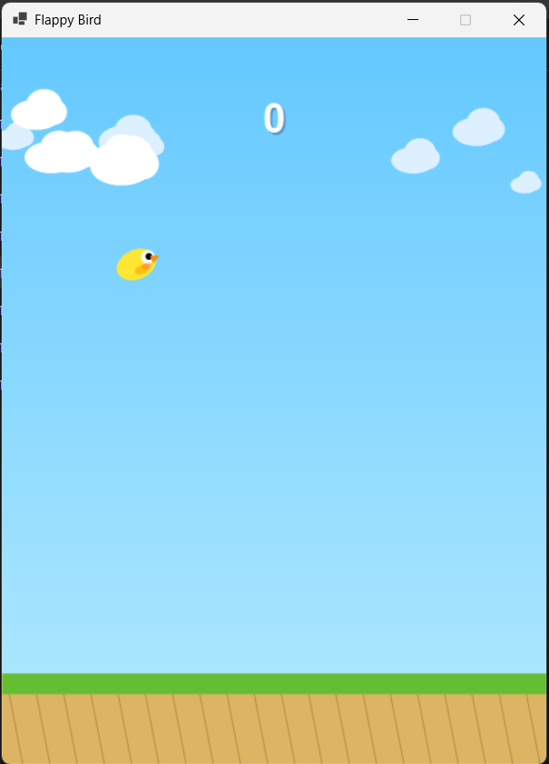
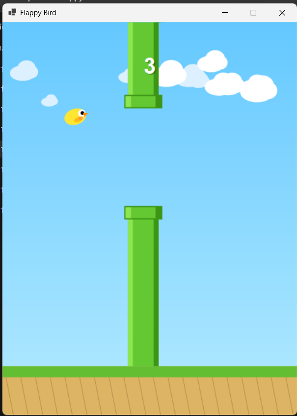

# Flappy Bird (Windows Forms C#)

Klasik retro Flappy Bird oyununun modern .NET ve C# Windows Forms mimarisi üzerinde sıfırdan geliştirilmiş masaüstü sürümüdür. Akıcı fizik dinamikleri, çift arabellekleme (double buffering) ile titremesiz grafikler ve tam klavye/fare desteği içerir.

---

## 📋 İçindekiler
1. [Proje Adı ve Kısa Açıklama](#proje-adı-ve-kısa-açıklama)
2. [Kullanılan Teknoloji / NuGet Paketleri](#kullanılan-teknoloji--nuget-paketleri)
3. [Kurulum ve Çalıştırma Adımları](#kurulum-ve-çalıştırma-adımları)
4. [Uygulamanın Temel Özellikleri](#uygulamanın-temel-özellikleri)
5. [Ekran Görüntüleri](#ekran-görüntüleri)
6. [Bilinen Sınırlamalar / Geliştirme Notları](#bilinen-sınırlamalar--geliştirme-notları)
7. [Öğrenci Bilgileri](#öğrenci-bilgileri)

---

## 1. Proje Adı ve Kısa Açıklama
- **Proje Adı:** Flappy Bird
- **Açıklama:** Windows Forms ve GDI+ vektörel çizim motoru kullanılarak oluşturulmuş tek oyunculu arcade oyunu. Kuşun yerçekimine karşı zıplayarak boru engellerinden geçmesi ve en yüksek skoru elde etmesi hedeflenmektedir.

---

## 2. Kullanılan Teknoloji / NuGet Paketleri
- **Programlama Dili:** C# 11+
- **Çalışma Zamanı (Runtime):** .NET (Windows Forms)
- **Grafik Motoru:** System.Drawing (GDI+ Çift Arabellekli Vektör Çizimi)
- **NuGet Paketleri:** Harici bir üçüncü parti NuGet paketi **kullanılmamıştır**. Proje tamamen yerel .NET Core / Windows Desktop SDK kütüphaneleriyle bağımsız ve taşınabilir olarak geliştirilmiştir.

---

## 3. Kurulum ve Çalıştırma Adımları

### Gereksinimler
- Windows 10 / 11 İşletim Sistemi
- [.NET SDK](https://dotnet.microsoft.com/download) (veya Visual Studio 2022+)

### Adım Adım Çalıştırma
1. **Depoyu Klonlayın veya İndirin:**
   ```bash
   git clone https://github.com/mustafahaccar18-art/FlappyBird.git
   cd FlappyBird
   ```

2. **Projeyi Derleyin:**
   ```bash
   dotnet build
   ```

3. **Uygulamayı Başlatın:**
   ```bash
   dotnet run
   ```
   *(Alternatif olarak `FlappyBird.csproj` dosyasını Visual Studio ile açıp `F5` tuşuna basarak da başlatabilirsiniz.)*

---

## 4. Uygulamanın Temel Özellikleri
- 🎮 **Evrensel Kontrol Mekanizması:** Klavyedeki **herhangi bir tuşa basıldığında** veya ekranda herhangi bir yere **fare ile tıklandığında** kuş zıplar (`KeyPreview` & `MouseDown`).
- 🕊️ **Gelişmiş Kuş Fiziği ve Animasyonu:** Yerçekimi ivmesi, hıza göre dinamik burun açısı (düşerken aşağı, zıplarken yukarı eğim) ve 3 kareli kanat çırpma animasyonu.
- 🌵 **Dinamik Boru Mekaniği:** Prosedürel olarak rastgele boşluk yükseklikleriyle üretilen gölgelendirmeli ve başlıklı boru sütunları.
- 🏆 **Skor ve Rekor Takibi:** Her boru geçildiğinde artan skor paneli ve oturum boyunca tutulan En Yüksek Skor (Best Score).
- 💥 **Çarpışma Kontrolü (Hitbox):** Tavan, zemin ve borular için hassas dikdörtgen kesişim denetimi.
- 🖥️ **Yumuşak & Titremesiz Grafik (Double Buffering):** ~60 FPS hızında çalışan `System.Windows.Forms.Timer` ve donanım dostu GDI+ çizimi.
- 🎖️ **Oyun Sonu (Game Over) ve Madalya:** Skora göre verilen başarı madalyaları (🥇 Altın, 🥈 Gümüş, 🥉 Bronz).

---

## 5. Ekran Görüntüleri

| Ekran Görüntüsü 1: Başlangıç ve Oyun Alanı | Ekran Görüntüsü 2: Boru Geçişi ve Canlı Skor |
| :---: | :---: |
|  |  |

---

## 6. Bilinen Sınırlamalar / Geliştirme Notları
- **Ses Efektleri:** Şu anki sürümde ses efektleri (zıplama, skor ve çarpma sesleri) eklenmemiştir. İlerleyen versiyonlarda `System.Media.SoundPlayer` entegrasyonu ile eklenecektir.
- **Kalıcı Skor:** En yüksek skor (Best Score) oyun açık kaldığı sürece hafızada (RAM) korunur; oyun kapatıldığında sıfırlanır. Kalıcı dosya/JSON kaydı yol haritasındadır.
- **Zorluk Seviyesi:** Boruların hız ve sıklığı sabit olup seviye ilerledikçe artan dinamik zorluk modu eklenebilir.

---

## 7. Öğrenci Bilgileri
- **Öğrenci Adı Soyadı:** Mustafa Haccar
- **Öğrenci Numarası:** `[Öğrenci Numaranızı Buraya Ekleyiniz]`
